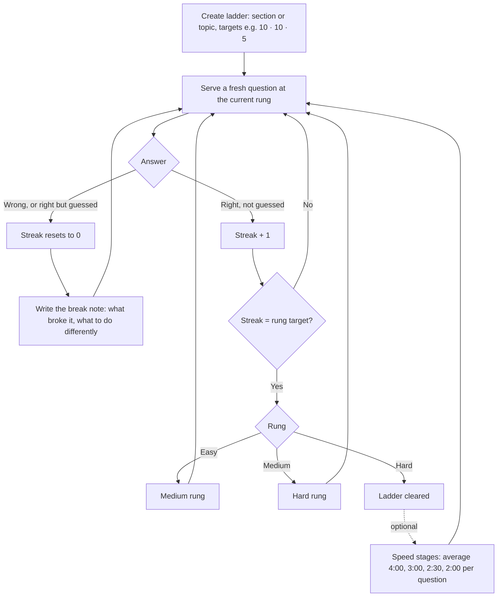

# Streaks Trainer

A small local web app for streak-based mastery practice on any multiple-choice subject: one topic at a time, easy to hard, where a single miss resets the streak.

## Why it exists

Percent-correct hides weak spots: 80 % on a topic can mean you know it, or that you guess well. A streak is a stricter test. You only move from easy to medium to hard questions after getting N in a row, and any miss, or any right answer you guessed, sends the count back to zero. The useful part is what happens at each break: you write down what went wrong and what you will do differently before the next question. This app enforces that loop so it cannot be skipped, and keeps the record so the patterns show. The method itself is described in [METHOD.md](METHOD.md).

## How a ladder works



## Features

- **Ladders** over a whole section or one topic, with easy, medium and hard rungs and preset or custom streak targets (default 10 · 10 · 5).
- **Strict streaks.** A miss resets the counter; so does a right answer marked "I guessed" (key G).
- **Required break notes.** The server will not serve the next question until the break has a written note; an optional break type (concept, calculation, misread, approach, guessed, other) is totaled on the home screen.
- **No repeats.** A question is served at most once, ever, so a streak cannot come from memory.
- **Balanced topics.** On a section ladder, each topic with fresh questions is equally likely.
- **Speed stages** after the hard rung, cleared on a rolling average time per question.
- **Tracker** per ladder: every run, where it broke, the note, and questions used versus target.
- **Bad-question handling.** Void an answered question with a wrong key (the streak is recounted), or skip an unreadable one before answering.
- **Bring your own questions** from CSV or JSON with `import_items.py`, validated, with `--dry-run`.
- **Terminal views:** `streaks.py status` and a read-only `streaks.py report`.

## How it works

- **One server file, standard library only.** `streaks.py` is an `http.server` app over SQLite, and `streaks_ui.html` is a single page with plain JavaScript. There is nothing to install and nothing leaves the machine; the server binds to `127.0.0.1`.
- **The server owns the rules.** The browser never receives the answer key before answering. Streaks, clears and the break-note gate are computed on the server from the `attempts` table, so the UI cannot drift from the method.
- **History is never rewritten.** Every answer is a row; the current streak is derived by counting back from the latest answer. Voiding a bad question marks the attempt instead of deleting it, and the streak is recomputed.
- **Data-driven subjects.** Sections and topics come from `taxonomy.json`; nothing about a subject is built into the code. Adding a subject means adding a section there and importing questions.
- **A clear is a recorded event.** When a rung clears, a `clears` row stores the questions used, breaks and average time, which is what the tracker and report read.

## Quick start

Requirements: Python 3.9 or newer. No packages.

```bash
python3 make_sample_bank.py          # builds streaks.db with 66 original demo questions
python3 streaks.py serve --open      # http://127.0.0.1:8791
```

The demo bank has two sections (Math: arithmetic, algebra, number properties; Logic: deduction, sets) with 12 Math and 10 Logic questions per difficulty. That is too few for a 10 · 10 · 5 ladder, so for a demo pick **custom** targets such as 3 · 3 · 2 when you create the ladder.

Other commands:

```bash
python3 streaks.py serve --port 9000         # another port
python3 streaks.py status                    # ladders and bank in the terminal
python3 streaks.py report [--since 2026-01-01]
STREAKS_DB=/path/to/other.db python3 streaks.py serve   # use another database
```

Keys in the practice view: A to E pick a choice, G toggles "I guessed", Enter submits and moves on.

## Load your own questions

1. Add your sections and topics to `taxonomy.json`.
2. Write a CSV or JSON file with `section, topic, difficulty, stem, choices, key, explanation`.
3. Check it, then import it:

```bash
python3 import_items.py my_questions.csv --dry-run
python3 import_items.py my_questions.csv
```

CSV example (`sample/example.csv`):

```csv
section,topic,difficulty,stem,choice_a,choice_b,choice_c,choice_d,key,explanation
Math,algebra,Easy,"If 3x = 21, what is x?",6,7,8,18,B,Divide both sides by 3.
```

`key` is the letter of the right choice. Rows with an unknown section or topic, a bad difficulty, duplicate choices or an out-of-range key are rejected with a reason; questions already in the bank are skipped. The full format is in [docs/ITEM-FORMAT.md](docs/ITEM-FORMAT.md). Only import questions you have the right to use.

## Project structure

```
streaks.py               server, SQLite schema, ladder logic, CLI (serve, status, report)
streaks_ui.html          single-page UI
import_items.py          CSV/JSON importer with validation and --dry-run
report.py                read-only report behind `streaks.py report`
taxonomy.json            sections and topics (example: Math, Logic)
make_sample_bank.py      builds the demo database
sample/sample_questions.py   generates the demo questions and checks every key by code
sample/example.csv       three-row CSV example
METHOD.md                the method and the app's additions, with reasons
docs/ITEM-FORMAT.md      question file format
```

## Status

Originally built for personal practice; this public copy is a generalized version with the subject-specific parts and the original question bank removed. The core loop (ladders, break notes, clears, speed stages, tracker, importer) was exercised end to end against the demo bank through the JSON API. There are no automated tests. Known limits: single user, no accounts, and the demo bank is small. The sample questions are generated from templates, so they are simple by design.

## How this was built

Ryan Wisth built this by directing AI coding agents (Claude Code): he set the goals, the rules of the method to enforce, and the acceptance checks, and he verified the results by using the app. Most of the code was written by the agents under that direction, not by hand.

## License

MIT. See [LICENSE](LICENSE). The streak method is credited in [METHOD.md](METHOD.md); this project is not affiliated with its author.
